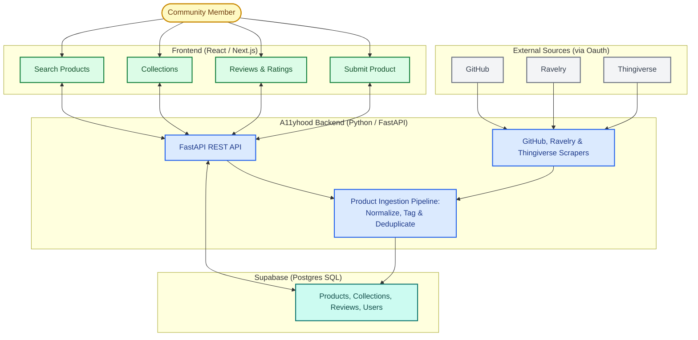

# Development Guide

This guide covers development standards for working with A11yhood. It currently focuses only on the frontend, the backend is still a TODO item. Testing and data model information also still needs to be added. If you haven't set up your local environment yet, start with the [Setup Guide](./docs/setup/SETUP.md).

---

## Table of Contents

- [Overall Architecture](#architecture)
- [Frontend Guidelines](#frontend-guidelines)
  - [Accessibility and Semantic HTML](#accessibility-and-semantic-html)
---

## Architecture

The overall goal of A11yhood is to make it easier to find open source accessibility, because such products are currently buried on websites that have thousands or millions of products. This is handled via automated discovery through scraping alongside community contribution and curation. We allow people to add products that may not appear in the scraped sources. Products can be rated and reviewed, or you can click through to the source product.

A11yhood's architecture was designed to support accessibility both in the repository's content and in the user experience. Products from all sources pass through a shared ingestion pipeline that normalizes metadata, applies tags, and removes duplicates before data is stored. This creates a more consistent search and browsing experience regardless of whether a product originated on GitHub, Ravelry, Thingiverse, or from a community submission. A11yhood imports metadata rather than mirroring entire projects, allowing users to discover accessibility technologies through a consistent interface while still accessing content on the original platform.

To improve the accessibility of product information, users who submit products are required to provide alternative text for uploaded images. For imported products, existing alternative text is prioritized whenever it is available (over images without it). This helps preserve accessibility metadata and makes product information more usable for screen reader users.

Accessibility was also considered in the development process itself. The website includes automated accessibility testing and continuous integration checks during code review and pull request workflows to try to catch problems before they reach production.

## Frontend Guidelines

The frontend is a React project written in TypeScript. The guiding principle for contributions is to **follow existing patterns and minimize duplicate code** — before adding a new utility, component, or type, check whether something already exists that can be reused or extended. 

Please note that this project is currently based on legacy code, including AI generated code. We are still working as a team to identify the resulting inefficiencies and reduce them. 

### Accessibility and Semantic HTML

Accessibility is a core value of this project, and the interface must reflect that commitment. All frontend contributions are expected to follow these conventions:

**Use semantic HTML.** Prefer native HTML elements that carry meaning over generic containers. Use `<button>` for actions, `<nav>` for navigation, `<main>` for primary content, `<section>` and `<article>` to organize content, and heading elements (`<h1>`–`<h6>`) in correct hierarchical order.
For `<section>` use the Section compontent.

**Do not use `div` or `span` where a semantic element exists.** If an element is clickable, it should be a `<button>` or `<a>` — not a `
` with an `onClick`. This ensures keyboard accessibility and correct screen reader behavior.

**Use ARIA only when native HTML is not sufficient.** Correct semantic HTML reduces or eliminates the need for ARIA. Add ARIA attributes only when there is no native HTML equivalent for the role or state you need to communicate.

**Ensure keyboard accessibility.** All interactive elements must be reachable and operable via keyboard. Do not remove or suppress focus styles.

**Do not rely on color alone to convey meaning.** Any information communicated through color must also be communicated through text or another visual indicator.

